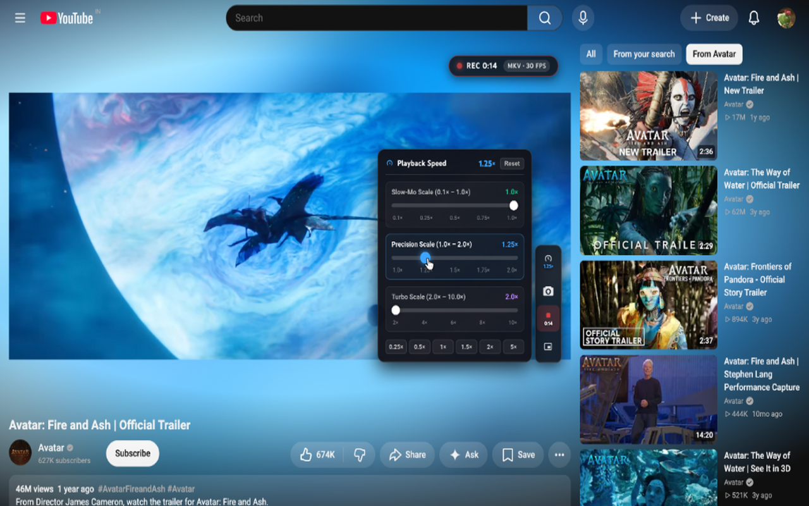
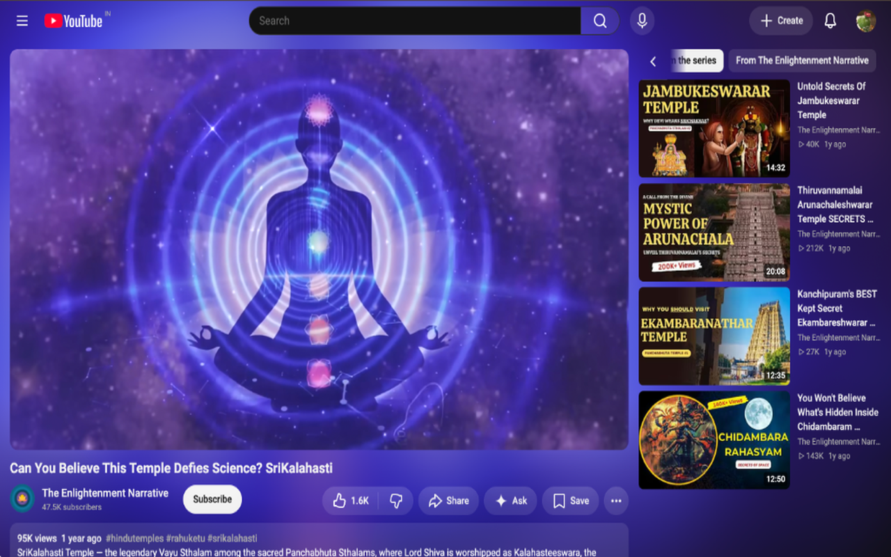

# CineGlow Pro for YouTube

CineGlow adds a soft glow around the YouTube player, using colours from the video as it plays. You can keep it subtle or turn up the spread and saturation for a stronger effect. It runs in Chrome without extra hardware.

There are playback tools too: an equaliser, volume and speech controls, a speed menu, screenshots, video recording, and a theatre layout that gives the player more room. Most controls live in the extension popup; the floating player toolbar puts the actions you use while watching within reach.

## See it in use

|  |  |
|:---:|:---:|
| Glow follows the video colours | Playback, precision speed, and lighting tools |

|  |  |
|:---:|:---:|
| Frame rate, resolution, and codec details | A centred player with fewer distractions |

|  |  |
|:---:|:---:|
| Auto-detect and crop black bars | Picture-in-picture, speed, screenshot, and recording controls |

## What's new in version 2.4.0

- **ScreenX Mode (default ON):** 4-sided edge extrusion (`640×360` canvas) extends the top, bottom, and side frame edges smoothly around the player, paired with automatic watch-page Dark Cinema styling and readable frosted filter chips, playlist panels, and owner metadata.
- **Live-tinted editorial popup:** Unified ambient top strip with sticky underline tabs (`Lighting | Video | Audio | Tools`), neutral monochrome fallback when idle, and live sampled 4-edge tinting across controls and `Active Edges`.
- **Overlay-tolerant black bar auto-crop:** Detects and crops symmetrical 21:9 letterbox/pillarbox bars cleanly even when a corner watermark or bottom subtitle sits inside the black band.
- **Interactive A-B Looper & shortcut guide:** Loop any segment (`[` / `]` / `\` / `Esc`) via an on-player Shadow DOM HUD and an in-popup **Keyboard Shortcuts & Controls** guide when turned on.
- **SponsorBlock & chapter skipping:** Auto-skips or fast-forwards (`16×`) sponsored segments with timeline markers and one-click Undo, plus **Hide End Screens** (`hideEndCards`) enabled by default.
- **Reliable load & autoplay start:** Resumes stalled loads and playlist autoplay transitions cleanly on `canplay` while keeping `Fill Ultrawide Screen` (`scale(1.34)`) and fullscreen rendering intact.

## What's new in version 2.3.0

- **Store policy compliance:** Renamed to "CineGlow Pro for YouTube" and removed unused permissions and legacy downloader methods.
- **Refined ad playback controller:** Preserves user-initiated mute settings and binds unmuting strictly to modified video elements during SPA transitions.
- **Dynamic audio headroom protection:** Scales input gain smoothly under heavy EQ and bass boost across all volume levels to prevent digital distortion.
- **Sync storage write throttling:** Implemented a 550ms throttle to prevent quota exhaustion when rapidly dragging sliders.

## What's new in version 2.2.0

- **Calm, uncluttered popup:** Settings are now grouped into clean, compact cards with clearer toggles, making it much easier to find what you want without scrolling through a long list of sliders.
- **One-click reload button:** Added a refresh button right in the popup header to instantly sync the active YouTube tab when changing major settings.
- **Smarter black bar auto-crop:** Cinematic movies and trailers with black letterbox borders now crop cleanly, using your entire display without awkward stutter.
- **Tuned audio boosters:** Bass boost and vocal clarity filters have smoother headroom protection, avoiding distortion on laptop speakers or headphones.
- **High-res visual gallery & video walkthrough:** Refreshed all store screenshots to full clarity and added a narrated 1080p demo video.

## What you can change

### Ambient lighting

The glow runs in either **ScreenX Mode** (default ON — a `640×360` 4-sided edge extension using a tuned cinema profile) or **Classic Mode** (`128×72` canvas with adjustable presets).

In Classic Mode, adjust intensity, spread, blur, saturation, contrast, brightness, and smoothness, or enable bass-reactive glow. Each edge has its own switch, and an optional setting keeps the glow active while in picture-in-picture.

### Video and layout

- **Cinema theatre mode** hides the YouTube header and recommendations around the centred player.
- **Lights Out** dims the surrounding watch-page UI (`Shift+D`, `95%` default dimming with hover reveal).
- **Auto-Crop Black Bars** detects and trims dark letterbox/pillarbox borders cleanly. **Fill Ultrawide Screen** zooms 21:9 videos (`1.34×`) inside the player container.
- **Video filters** adjust brightness, contrast, and sepia warmth.
- **Auto Video Quality** (`hd1080` default, or `720p` / `1440p` / `4K` / `Max`) and **Default playback speed** (`0.1×`–`2×`, up to `10×` from the floating menu).
- **Hide Scrollbar** removes the watch-page scrollbar.

Cropping and zooming can cut off part of the image. Turn them off when you want to see the full frame.

### Audio

The audio controls work through the browser's Web Audio API:

- **Audio Normaliser** uses compression to reduce the difference between quieter and louder passages. It changes audio dynamics; it is not a fixed-gain loudness match between videos.
- **Volume boost** goes from 100% to 300% of the normal level.
- **Bass boost** adds up to 15 dB through an 80 Hz low-shelf filter.
- **Vocal clarity** adds up to 12 dB around 2.5 kHz.
- **Five-band EQ** covers 60 Hz, 250 Hz, 1 kHz, 4 kHz, and 12 kHz, with ±12 dB per band.
- **Presets** include Flat, Bass, Vocal, Rock, Pop, and EDM. Manual changes appear as Custom.

A limiter follows the volume boost to help control peaks. Start with a small boost and adjust by ear.

### Player tools

The floating toolbar adds picture-in-picture, screenshots, recording, and speed controls. Screenshots save the current video frame as a PNG at its source resolution.

The recorder captures the video image and available video audio, rather than the whole tab or desktop. It offers MKV, WebM, and MP4 preferences at 30 or 60 fps. The current implementation scales recordings to fit within 1920×1080 and falls back to a supported format when necessary. Use the format badge, options button, or right-click menu to change recording settings.

The speed menu has slow-motion, precision, and turbo ranges, plus quick buttons for 0.25×, 0.5×, 1×, 1.5×, 2×, and 5×.

### Playback statistics

The draggable stats panel shows display and video frame rates, dropped frames, glow update rate, video dimensions, codecs, and a frame-timing graph. It also labels colour depth and SDR/HDR formats using the metadata available from YouTube. Those labels describe the stream information; they do not certify the display's HDR output.

### Tools & playback utilities

- **A-B Looper** repeats any segment (`[` Set A, `]` Set B, `\` Toggle, `Esc` Clear) with a timeline overlay, on-player HUD, and an inline keyboard guide in the popup when enabled.
- **Smart Auto-Pause** pauses playback when leaving the tab or switching apps (`off` | `tab` | `app`).
- **SponsorBlock** (`Auto-skip` or `16× Fast-forward`) marks and skips sponsored segments with Undo support.
- **Smart AdBlock** skips ads and blocks bundled ad and tracker rules.
- **Return YouTube Dislike** fetches community dislike counts when enabled.
- **Classic Annotations** restores archived notes and spotlights where available.
- **Hide Shorts** removes Shorts shelves and feeds; **Hide End Screens** (`true` by default) removes end-card overlays.
- **Codec and frame-rate switches** ask YouTube to avoid AV1, VP9, or 60 fps playback.

YouTube changes its player and page layout regularly, so features that depend on those elements may need updates.

## Install locally

1. Clone the repository:

   ```bash
   git clone https://github.com/ManoharVit/YouTube-CineGlow.git
   ```

2. Open `chrome://extensions` and turn on **Developer mode**.
3. Click **Load unpacked** and select the cloned folder.
4. Open a YouTube video, then click the CineGlow toolbar icon to adjust the settings.

The manifest declares Chrome 111 as the minimum version. Individual media and recording features also depend on the browser's API and codec support.

## Settings and privacy

Preferences are saved through `chrome.storage.sync`, so Chrome can sync them across your signed-in devices when sync is enabled. Archived annotations are cached in `chrome.storage.local`. Screenshots and recordings are saved on your computer.

Glow rendering and audio processing happen in the browser. Optional lookup features contact SponsorBlock (`sponsor.ajay.app`), the Return YouTube Dislike API (`returnyoutubedislikeapi.com`), and the annotation archive (`storage.googleapis.com`) using the video ID when those features are enabled. See [PRIVACY.md](PRIVACY.md) for what is stored and sent.

## How the glow works

1. `drawImage()` copies the current video frame onto the sampling canvas (`640×360` in ScreenX Mode, `128×72` in Classic Mode).
2. In ScreenX Mode, edge strips are extended outward across all 4 sides; in Classic Mode, frames blend according to the smoothness setting.
3. CSS scales, blurs, and masks the canvas behind the transparent page layers (`z-index: -1`).
4. Playback state and page visibility determine when the loop runs cleanly without interfering with fullscreen or background tabs.

## Project layout

```text
manifest.json              Extension permissions, MV3 config, and script registration
background/background.js   Messages, downloads, network rules, optional lookups
content/
  player-manager.js        Player discovery, navigation, and playback state
  content.js + content.css Glow/ScreenX rendering, dark cinema theme, popup edge sampling
  blackbar.js              Overlay-tolerant black-border detection and auto-crop
  ab-loop.js               Interactive A-B section looper & Shadow DOM HUD
  lights-out.js            Lights Out focus dimmer (Shift+D)
  sponsor-skip.js          SponsorBlock + chapter segment skipping
  stats-overlay.js + .css  Playback statistics and frame-timing graph
  audio-processor.js       Compression, volume, EQ, and frequency analysis
  pip-button.js            Picture-in-picture control
  screenshot-button.js     PNG frame capture
  record-button.js         Video-element recording and format selection
  speed-button.js          Playback-speed menu and presets
  smart-pause.js           Tab/window-based pause behaviour
  youtube-ads.js           Ad detection and skip-button handling
  youtube-quality.js       Preferred-resolution selection
  annotations.js           Archived annotation display
  hide-endcards.js         End-screen and card overlay removal
  hide-shorts.js           Shorts shelf and feed removal
  return-dislikes.js       Dislike-count display
  main-world.js            Page-context hooks, load/autoplay recovery, player stats
icons/fonts/               Bundled offline UI display and Noto Emoji .woff2 fonts
popup/                     Live-tinted settings popup UI
shared/defaults.js         Default setting values
rules/adblock.json         Bundled ad and tracker request rules
test/                      Node-based test suite
store_assets/              Store screenshots and promotional images
```

For implementation details and the settings reference, see [DOCUMENTATION.md](DOCUMENTATION.md).

## Author and licence

Giri Manohar Vemula · [GitHub](https://github.com/ManoharVit) · [LinkedIn](https://www.linkedin.com/in/manoharv511)

[MIT licence](LICENSE), © 2026 Giri Manohar Vemula.
