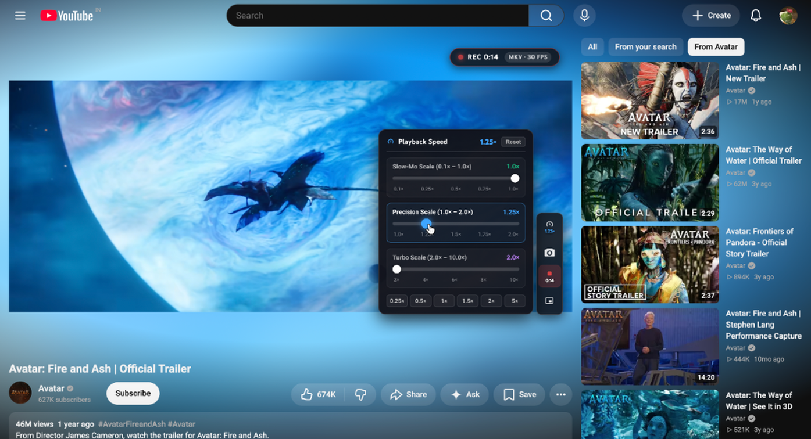
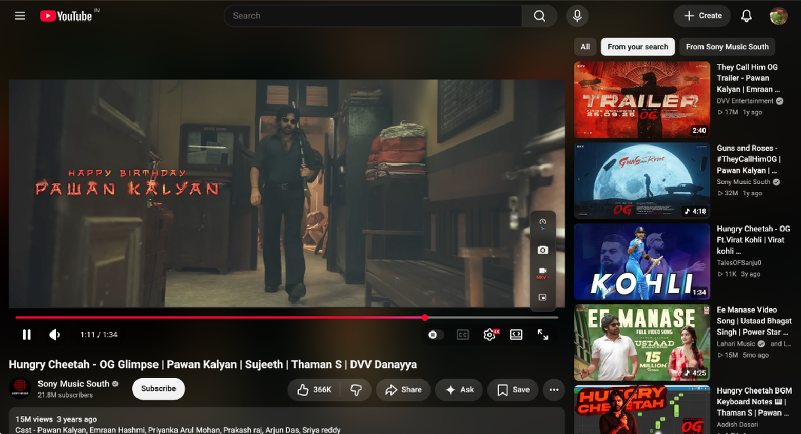

# YouTube CineGlow Pro

CineGlow adds a soft glow around the YouTube player, using colours from the video as it plays. You can keep it subtle or turn up the spread and saturation for a stronger effect. It runs in Chrome without extra hardware.

There are playback tools too: an equaliser, volume and speech controls, a speed menu, screenshots, video recording, and a theatre layout that gives the player more room. Most controls live in the extension popup; the floating player toolbar puts the actions you use while watching within reach.

## See it in use

|  |  |
|:---:|:---:|
| Glow follows the video colours | Playback, precision speed, and lighting tools |

|  |  |
|:---:|:---:|
| Frame rate, resolution, and codec details | A centred player with fewer distractions |

|  |  |
|:---:|:---:|
| Auto-detect and crop black bars | Picture-in-picture, speed, screenshot, and recording controls |

## What's new in version 2.2.0

- **Calm, uncluttered popup:** Settings are now grouped into clean, compact cards with clearer toggles, making it much easier to find what you want without scrolling through a long list of sliders.
- **One-click reload button:** Added a refresh button right in the popup header to instantly sync the active YouTube tab when changing major settings.
- **Smarter black bar auto-crop:** Cinematic movies and trailers with black letterbox borders now crop cleanly, using your entire display without awkward stutter.
- **Tuned audio boosters:** Bass boost and vocal clarity filters have smoother headroom protection, avoiding distortion on laptop speakers or headphones.
- **High-res visual gallery & video walkthrough:** Refreshed all store screenshots to full clarity and added a narrated 1080p demo video.

## What you can change

### Ambient lighting

The glow comes from a small 128×72 canvas that samples the video. Blur and colour filters spread it behind the player, while temporal smoothing softens changes between frames.

Adjust opacity, spread, blur, saturation, contrast, brightness, and smoothness. Each edge has its own switch, so you can keep the glow on just the top and sides, for example. Audio-reactive mode changes its size and brightness with bass energy. An optional setting keeps the glow on the original page while the video is in picture-in-picture.

### Video and layout

- **Cinema theatre mode** hides the YouTube header and recommendations around the centred player.
- **Lights Out** dims the page around the video.
- **Auto-Crop Black Bars** detects dark borders in the video and crops them. **Ultrawide Zoom-to-Fit** provides a separate option for 21:9 displays.
- **Video filters** adjust brightness, contrast, and sepia warmth.
- **Preferred quality** asks YouTube for 720p, 1080p, 1440p, 4K, or the maximum available quality when a video loads. The video still needs to offer that resolution.
- **Hide Page Scrollbar** removes the scrollbar on watch pages.
- **Default playback speed** has a 0.1× to 2× slider in the popup. The floating speed menu extends the range to 10×.

Cropping and zooming can cut off part of the image. Turn them off when you want to see the full frame.

### Audio

The audio controls work through the browser's Web Audio API:

- **Audio Normaliser** uses compression to reduce the difference between quieter and louder passages. It changes audio dynamics; it is not a fixed-gain loudness match between videos.
- **Volume boost** goes from 100% to 300% of the normal level.
- **Bass boost** adds up to 15 dB through an 80 Hz low-shelf filter.
- **Vocal clarity** adds up to 12 dB around 2.5 kHz.
- **Five-band EQ** covers 60 Hz, 250 Hz, 1 kHz, 4 kHz, and 12 kHz, with ±12 dB per band.
- **Presets** include Flat, Bass, Vocal, Rock, Pop, and EDM. Manual changes appear as Custom.

A limiter follows the volume boost to help control peaks. Start with a small boost and adjust by ear.

### Player tools

The floating toolbar adds picture-in-picture, screenshots, recording, and speed controls. Screenshots save the current video frame as a PNG at its source resolution.

The recorder captures the video image and available video audio, rather than the whole tab or desktop. It offers MKV, WebM, and MP4 preferences at 30 or 60 fps. The current implementation scales recordings to fit within 1920×1080 and falls back to a supported format when necessary. Use the format badge, options button, or right-click menu to change recording settings.

The speed menu has slow-motion, precision, and turbo ranges, plus quick buttons for 0.25×, 0.5×, 1×, 1.5×, 2×, and 5×.

### Playback statistics

The draggable stats panel shows display and video frame rates, dropped frames, glow update rate, video dimensions, codecs, and a frame-timing graph. It also labels colour depth and SDR/HDR formats using the metadata available from YouTube. Those labels describe the stream information; they do not certify the display's HDR output.

### Other options

- **Smart AdBlock** attempts to skip ads and blocks requests that match the bundled ad and tracker rules.
- **Return YouTube Dislike** fetches community dislike counts when enabled.
- **Restore Classic Annotations** loads archived notes, speech bubbles, and spotlights where an archive is available.
- **Hide Shorts** removes Shorts shelves and feed entries.
- **Hide End Screens & Cards** removes end-card and information-card overlays.
- **Codec and frame-rate switches** ask YouTube to avoid AV1, VP9, or 60 fps playback.
- **Smart Auto-Pause** can pause playback when you leave the tab or the Chrome window, depending on the selected mode.

YouTube changes its player and page layout regularly, so features that depend on those elements may need updates.

## Install locally

1. Clone the repository:

   ```bash
   git clone https://github.com/ManoharVit/YouTube-CineGlow.git
   ```

2. Open `chrome://extensions` and turn on **Developer mode**.
3. Click **Load unpacked** and select the cloned folder.
4. Open a YouTube video, then click the CineGlow toolbar icon to adjust the settings. YouTube's dark theme makes the glow easier to see.

The manifest declares Chrome 105 as the minimum version. Individual media and recording features also depend on the browser's API and codec support.

## Settings and privacy

Preferences are saved through `chrome.storage.sync`, so Chrome can sync them across your signed-in devices when sync is enabled. Archived annotations are cached in `chrome.storage.local`. Screenshots and recordings are saved on your computer.

Glow rendering and audio processing happen in the browser. The two optional lookup features contact the Return YouTube Dislike API and an annotation archive on Google Cloud Storage using the video ID. See [PRIVACY.md](PRIVACY.md) for what is stored and sent.

## How the glow works

1. `drawImage()` copies the current video frame onto the 128×72 canvas.
2. The new image is blended with the previous one according to the smoothness setting.
3. CSS scales, blurs, and colours the canvas behind the player.
4. Playback state and page visibility determine when the glow loop runs. Other enabled features, such as recording or the stats panel, have their own update loops.

## Project layout

```text
manifest.json              Extension permissions and script registration
background/background.js   Messages, downloads, network rules, optional lookups
content/
  player-manager.js        Player discovery, navigation, and playback state
  content.js + content.css Glow sampling, blending, and layout
  stats-overlay.js + .css  Playback statistics and frame-timing graph
  audio-processor.js       Compression, volume, EQ, and frequency analysis
  blackbar.js              Black-border detection and crop settings
  pip-button.js            Picture-in-picture control
  screenshot-button.js     PNG frame capture
  record-button.js         Video-element recording and format selection
  speed-button.js          Playback-speed menu and presets
  smart-pause.js           Tab/window-based pause behaviour
  youtube-ads.js            Ad detection and skip-button handling
  youtube-quality.js       Preferred-resolution selection
  annotations.js           Archived annotation display
  hide-endcards.js          End-screen and information-card removal
  hide-shorts.js            Shorts shelf and feed removal
  return-dislikes.js        Dislike-count display
  main-world.js            Page-context hooks and player statistics
popup/                     Extension controls and settings interface
shared/defaults.js         Default setting values
rules/adblock.json         Bundled ad and tracker request rules
test/                      Node-based tests
store_assets/              Store screenshots and promotional images
```

For implementation details and the settings reference, see [DOCUMENTATION.md](DOCUMENTATION.md).

## Author and licence

Giri Manohar Vemula · [GitHub](https://github.com/ManoharVit) · [LinkedIn](https://www.linkedin.com/in/manoharv511)

[MIT licence](LICENSE), © 2026 Giri Manohar Vemula.
