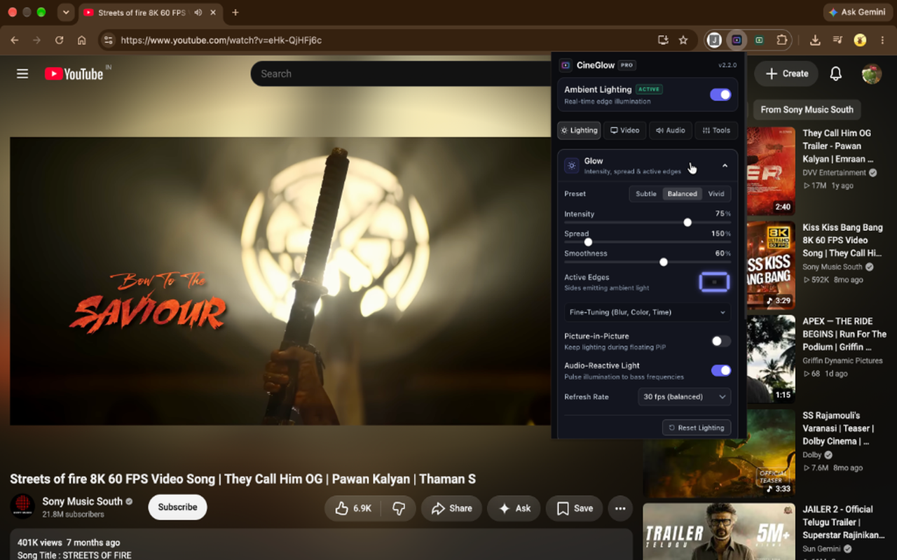
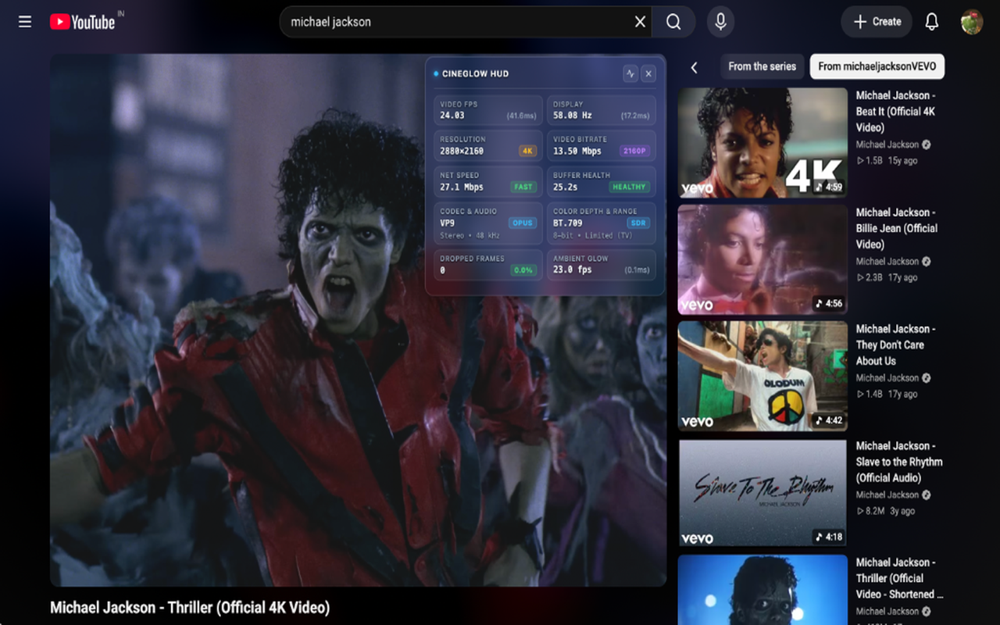
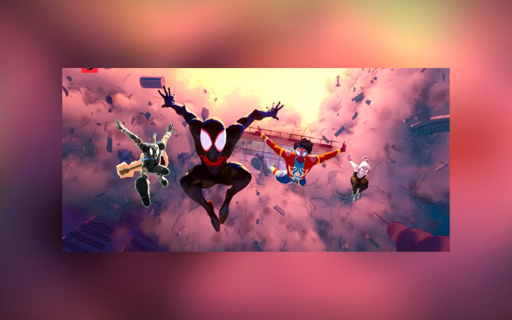
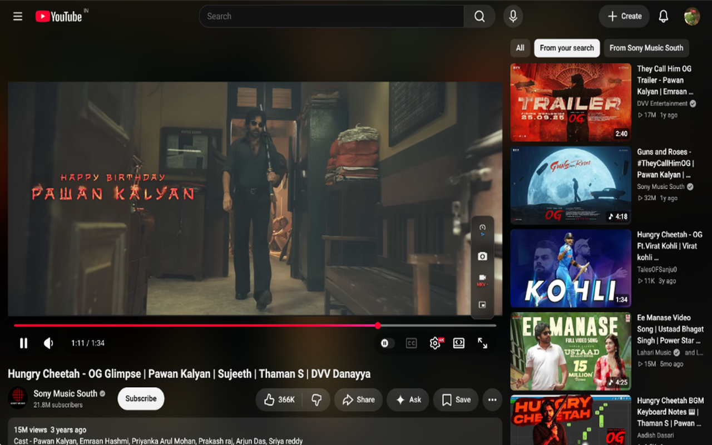

# CineGlow Pro for YouTube (v3.0.0)

CineGlow adds soft reactive lighting around the YouTube player using colours sampled from the video as it plays—either via 4-sided **ScreenX Mode** (default ON) or customizable **Classic Mode** ambient glow. It runs in Chrome without extra hardware.

There are playback tools too: a 5-band equaliser, Volume Normalizer (default ON), volume/bass/vocal boost, a speed menu, A-B section looper, Stats HUD, screenshots, video recording, ad/sponsor skipping, and clean theatre/focus layouts. Most controls live in the live-tinted popup; the floating player toolbar puts watching actions within reach.

## See it in use

|  |  |
|:---:|:---:|
| Glow follows the video colours | Playback, precision speed, and lighting tools |

|  |  |
|:---:|:---:|
| Frame rate, resolution, and codec details | A centred player with fewer distractions |

|  |  |
|:---:|:---:|
| Auto-detect and crop black bars | Picture-in-picture, speed, screenshot, and recording controls |

## What's new in version 3.0.0

Everything shipped after tag `v2.4.0` (`2026-11-12`) is part of **3.0.0**:

- **ScreenX Mode (default ON) & Dark Cinema theme:** 4-sided frame edge extrusion (`640×360` canvas, calibrated `16px` blur, outermost perimeter band sampling, and multi-stop radial mask) paired with automatic watch-page Dark Cinema styling and readable translucent header/filter chips, playlist panels, and owner/action controls even on YouTube Light Theme.
- **Live-tinted `Glow | Video | Audio | Tools` popup & offline UI fonts:** Unified ambient top strip with sticky underline tabs, neutral monochrome fallback when idle, live 4-edge frame color tinting across controls and `Active Edges` via a `willReadFrequently` offscreen sampler, bundled offline `.woff2` fonts (`Bricolage Grotesque` & `Noto Emoji` in `icons/fonts/`, plus `Noto Emoji` on YouTube overlays), updated `tablist`/`tabpanel` semantics, numeric control inputs, inline A-B Looper shortcut guide, and unified CSS design tokens.
- **Volume Normalizer (`audioNormalizer`) on by default & audio/speed updates:** Evens out quiet dialogue and loud effects right after install, alongside lazy `AudioContext` DSP initialization (preserving multi-channel audio when idle), `+9 dB` compressor makeup gain, DSP-bypass kill-switch, and speed-button event isolation, double-click/badge `1.0×` reset, and SPA navigation/ad-transition rate persistence.
- **SponsorBlock & chapter skipping (`sponsorBlockEnabled`, default ON):** Auto-skips or fast-forwards (`16×`) sponsored, self-promo, and interaction segments (with native YouTube chapter fallback), timeline markers, and one-click Undo.
- **Opt-in `Hide AI Videos` (`hideAiVideos`, off by default):** Filters feed and sidebar cards via YouTube's official synthetic/altered-content badges and MAIN-world Polymer `.data` / `ytInitialData` disclosures (sparing normal video titles) and pauses disclosed watch-page videos with **Skip to Next** and **Watch Anyway** controls (`content/hide-ai.js`, `content/main-world.js`).
- **End Screens, Shorts, Dislikes & AdBlock refinements:** **Hide End Screens** (`hideEndCards`, default ON) now also suppresses `.ytp-cards-teaser` and `.ytp-cards-button` overlays inside the player while AdBlock leaves creator info cards intact when end-screen hiding is off and removes anti-adblock enforcement backdrop scrims; **Hide Shorts** (`content/hide-shorts.js`) adds a `MutationObserver`-backed DOM fallback that un-hides recycled regular cards and scopes click interception to exact `/shorts` routes; **Return Dislikes** (`content/return-dislikes.js`) keys counts to the active video ID across recycled Shorts slide nodes.
- **Overlay-tolerant `Auto-Crop Black Bars`, A-B Looper & Lights Out refinements:** Crops via `clipPath` inset, tolerates corner watermarks and bottom subtitles inside black bars, prevents 4-edge miniature crops, releases within 2 frames when active content returns, locks unfocused secondary-monitor playback in ~6s, and hardens stalled load / `canplay` autoplay recovery while keeping `Fill Ultrawide Screen` (`scale(1.34)`) and fullscreen rendering unclipped; A-B Looper adds a precision loop boundary timer, `"Set Point A first ([)"` toast, and Shadow DOM `pointer-events: none` host scoping; Lights Out raises default dimming to `95%` with zero-opacity click-through protection.
- **Core reliability, MV3 hardening & expanded test suite:** `manifest.json` `exclude_matches` for `studio`/`accounts`/`consent` YouTube subdomains and updated host permissions (`sponsor.ajay.app`, `storage.googleapis.com`), Shadow DOM stats HUD styling (`stats-overlay.js`), centralized MV3 message authorization (`authorizeApiMessage`), annotation video ID format validation, serialized annotation LRU cache eviction, `AbortSignal`-aware network backoff (`shared/network-backoff.js`), URL-parsed `fetch` interception, `WeakSet` cycle guards, identity-checked `main-world.js` teardown, on-demand `captureStream(0)` recording, hardened helper scripts, and `464` automated tests across `89` suites (`npm test`).

## What's new in version 2.4.0

- **Interactive A-B Section Looper (`content/ab-loop.js`):** Loop any video segment (`[` Set A, `]` Set B, `\` Toggle, `Esc` or `Backspace` Clear) via an on-player Shadow DOM HUD and timeline progress bar range overlay.
- **Cinema Lights Out Dimmer (`content/lights-out.js`):** Dims surrounding watch-page UI (`Shift+D`, configurable dimming slider, and smart hover-to-reveal).
- **Recording audio-track indicator:** Live recording HUD badge displays `AUDIO` or `NO AUDIO` alongside the active format and frame rate.
- **Theater Mode hover-to-reveal header:** Auto-hides the top YouTube masthead in Clean Theater Mode with smooth hover and search-focus reveal.
- **Brave-grade AdBlock overhaul & CSP-safe black-bar scanner:** Deep player payload pruning, `fetch`/`XHR` ad-break neutralization, instant skip-button resolution, updated DNR rules, and removal of the Blob worker in `content/blackbar.js` for strict YouTube CSP compliance.
- **Local Chrome test launcher:** Added `tools/test-local.sh` (`npm run test:local`) to launch Chrome with the unpacked extension in an isolated temporary profile.

## What's new in version 2.3.0

- **Store policy compliance:** Renamed to "CineGlow Pro for YouTube" and removed unused permissions and legacy downloader methods.
- **Refined ad playback controller:** Preserves user-initiated mute settings and binds unmuting strictly to modified video elements during SPA transitions.
- **Dynamic audio headroom protection:** Scales input gain smoothly under heavy EQ and bass boost across all volume levels to prevent digital distortion.
- **Sync storage write throttling:** Implemented a 550ms throttle to prevent quota exhaustion when rapidly dragging sliders.

## What's new in version 2.2.0

- **Calm, uncluttered popup:** Settings are now grouped into clean, compact cards with clearer toggles, making it much easier to find what you want without scrolling through a long list of sliders.
- **One-click reload button:** Added a refresh button right in the popup header to instantly sync the active YouTube tab when changing major settings.
- **Smarter black bar auto-crop:** Cinematic movies and trailers with black letterbox borders now crop cleanly, using your entire display without awkward stutter.
- **Tuned audio boosters:** Bass boost and vocal clarity filters have smoother headroom protection, avoiding distortion on laptop speakers or headphones.
- **High-res visual gallery & video walkthrough:** Refreshed all store screenshots to full clarity and added a narrated 1080p demo video.

## What you can change

### Ambient lighting

The **Glow** tab runs lighting in either **ScreenX Mode** (default ON — a `640×360` 4-sided edge extension using a tuned cinema profile) or **Classic Mode** (`128×72` canvas with `Subtle`, `Balanced`, `Vivid`, and `Custom` presets).

**Active Edges**, **Fade-In**, **Picture-in-Picture Glow**, and **Refresh Rate** (`15 / 30 / 60 fps`) remain active in ScreenX Mode. Turn off ScreenX Mode to unlock Classic presets, Intensity, Spread, Smoothness, Blur Radius, Saturation, Contrast, Brightness, and Bass-Reactive Glow.

### Video and layout

- **Auto Video Quality** (`1080p` default, or `720p` / `1440p` / `4K` / `Max`) and **Default Playback Speed** (`0.1×`–`2×`, clickable/double-click `1.0×` reset, up to `10×` from the floating menu).
- **Auto-Crop Black Bars** detects and trims dark letterbox/pillarbox borders cleanly (default ON). **Fill Ultrawide Screen** zooms 21:9 videos (`1.34×`) inside the player container.
- **Clean Theater Mode** hides the YouTube masthead (hover at the top edge to reveal) and recommendations around the centred player.
- **Hide Scrollbar** removes the YouTube page scrollbar (default ON).
- **Lights Out Mode** dims the surrounding watch-page UI (`Shift+D`, `95%` default dimming with hover reveal).
- **Picture Filters** adjust **Brightness**, **Contrast**, and **Warm Tint** (sepia).
- **Codec Blockers** (**Block AV1**, **Block VP9**, **Block 60fps**) ask YouTube to avoid AV1, VP9, or high-frame-rate streams (blocking both AV1 and VP9 caps YouTube resolution at 1080p).

Cropping and zooming can cut off part of the image. Turn them off when you want to see the full frame.

### Audio

The audio controls work through the browser's Web Audio API:

- **Volume Normalizer** (default ON) uses compression to reduce the difference between quieter and louder passages. It changes audio dynamics; it is not a fixed-gain loudness match between videos.
- **Volume Boost** goes from `100%` to `300%` of the normal level.
- **Bass Boost** adds up to `15 dB` through an `80 Hz` low-shelf filter.
- **Vocal Clarity** adds up to `12 dB` around `2.5 kHz`.
- **5-Band Equalizer** covers `60 Hz`, `250 Hz`, `1 kHz`, `4 kHz`, and `12 kHz`, with `±12 dB` per band.
- **Presets** include **Flat**, **Bass**, **Vocal**, **Rock**, **Pop**, and **EDM**. Manual changes appear as custom.

A limiter follows the volume boost to help control peaks. Start with a small boost and adjust by ear.

### Player tools

The floating toolbar adds picture-in-picture, screenshots, recording, and speed controls. Screenshots save the current video frame as a PNG at its source resolution.

The recorder captures the video image and available video audio (showing `AUDIO` or `NO AUDIO` in the HUD), rather than the whole tab or desktop. It offers MKV, WebM, and MP4 preferences at 30 or 60 fps. The current implementation scales recordings to fit within 1920×1080 and falls back to a supported format when necessary. Use the format badge, options button, or right-click menu to change recording settings.

The speed menu has slow-motion, precision, and turbo ranges, plus quick buttons for 0.25×, 0.5×, 1×, 1.5×, 2×, and 5× (double-click the speed button to reset to `1.0×`).

### Playback statistics

The draggable stats panel shows display and video frame rates, dropped frames, glow update rate, video dimensions, codecs, and a frame-timing graph. It also labels colour depth and SDR/HDR formats using the metadata available from YouTube. Those labels describe the stream information; they do not certify the display's HDR output.

### Tools & playback utilities

- **Auto-Pause** pauses playback when leaving the tab or switching apps (`Off` | `On tab switch` | `On app switch`).
- **A-B Looper** repeats any segment (`[` Set A, `]` Set B, `\` Toggle, `Esc` or `Backspace` Clear) with a timeline overlay, on-player HUD, and an inline **Keyboard Shortcuts & Controls** guide in the popup when enabled.
- **Stats HUD** toggles the draggable real-time playback and glow telemetry panel.
- **Return Dislikes** fetches community dislike counts on watch pages and Shorts when enabled.
- **Hide Shorts** removes Shorts shelves, feeds, and sidebar entries, and redirects `/shorts/<id>` links to `/watch`.
- **Hide AI Videos** (opt-in) hides feed cards carrying YouTube's official AI/synthetic-content disclosure badges and pauses disclosed watch-page videos with **Skip to Next** and **Watch Anyway** actions.
- **Hide End Screens** (`true` by default) removes end-card overlays plus top-right `.ytp-cards-teaser` / `.ytp-cards-button` player overlays.
- **Classic Annotations** (opt-in) restores archived notes, speech bubbles, and spotlights where available.
- **Ad Blocker** (default ON) skips ads, prunes ad payloads, dismisses anti-adblock enforcement backdrops, and applies bundled ad and tracker DNR rules (`rules/adblock.json`).
- **SponsorBlock** (`Auto-skip` or `16x Fast-forward`, default ON) marks and skips sponsored segments (plus chapter fallback) with Undo support.

YouTube changes its player and page layout regularly, so features that depend on those elements may need updates.

## Install locally

1. Clone the repository:

   ```bash
   git clone https://github.com/ManoharVit/YouTube-CineGlow.git
   ```

2. Open `chrome://extensions` and turn on **Developer mode**.
3. Click **Load unpacked** and select the cloned folder.
4. Open a YouTube video, then click the CineGlow toolbar icon to adjust the settings.

The manifest declares Chrome 111 as the minimum version. Individual media and recording features also depend on the browser's API and codec support.

## Verify & package

- Run the automated test suite (`464` tests across `89` suites): `npm test`
- Launch Chrome with the extension unpacked in an isolated profile: `npm run test:local`
- Build the release archive (`YouTube-CineGlow-v3.0.0.zip`): `npm run package`

## Settings and privacy

Preferences are saved through `chrome.storage.sync`, so Chrome can sync them across your signed-in devices when sync is enabled (and enterprise policies in `managed-schema.json` can override them via `chrome.storage.managed`). Archived annotations and local UI/kill-switch state are stored in `chrome.storage.local`. Screenshots and recordings are saved on your computer.

Glow rendering and audio processing happen in the browser. Optional lookup features contact SponsorBlock (`sponsor.ajay.app`), the Return YouTube Dislike API (`returnyoutubedislikeapi.com`), and the annotation archive (`storage.googleapis.com`) using the video ID when those features are enabled. The popup uses bundled offline `.woff2` fonts (`icons/fonts/`), while YouTube page overlays load the `Noto Emoji` stylesheet from `fonts.googleapis.com`. See [PRIVACY.md](PRIVACY.md) for what is stored and sent.

## How the glow works

1. `drawImage()` copies the current video frame onto the sampling canvas (`640×360` in ScreenX Mode, `128×72` in Classic Mode).
2. In ScreenX Mode, edge strips are extended outward across all 4 sides; in Classic Mode, frames blend according to the smoothness setting. A separate small `willReadFrequently` offscreen canvas samples edge colours for live popup tinting without stalling the main canvas.
3. CSS scales, blurs, and masks the canvas behind the transparent page layers (`z-index: -1`).
4. Playback state and page visibility determine when the loop runs cleanly without interfering with fullscreen or background tabs.

## Project layout

```text
manifest.json              Extension permissions, MV3 config, and script registration
managed-schema.json        Chrome Enterprise managed storage policy schema
background/background.js   Messages, DNR rules, codec registration, policy sync, API lookups
content/
  player-manager.js        Player discovery, navigation, and playback state
  content.js + content.css Glow/ScreenX rendering, dark cinema theme, popup edge sampling
  blackbar.js              Overlay-tolerant black-border detection and clipPath auto-crop
  ab-loop.js               Interactive A-B section looper & Shadow DOM HUD
  lights-out.js            Lights Out focus dimmer (Shift+D)
  sponsor-skip.js          SponsorBlock + chapter segment skipping
  stats-overlay.js         Playback statistics and frame-timing HUD (Shadow DOM CSS; legacy stats-overlay.css)
  audio-processor.js       Compression, volume, EQ, and frequency analysis
  pip-button.js            Picture-in-picture control
  screenshot-button.js     PNG frame capture
  record-button.js         Video-element recording and format selection
  speed-button.js          Playback-speed menu and presets
  smart-pause.js           Tab/window-based pause behaviour
  youtube-ads.js           Ad detection and skip-button handling
  youtube-quality.js       Preferred-resolution selection
  annotations.js + .css    Archived annotation display
  hide-ai.js               Opt-in official AI/synthetic-content disclosure filter
  hide-endcards.js         End-screen and info-card overlay removal
  hide-shorts.js           Shorts shelf and feed removal
  return-dislikes.js       Dislike-count display (watch pages & Shorts)
  block-av1.js             Dynamic MAIN-world AV1 blocker
  block-vp9.js             Dynamic MAIN-world VP9 blocker
  block-60fps.js           Dynamic MAIN-world >30 fps stream blocker
  main-world.js            Page-context hooks, load/autoplay recovery, AI disclosure & player stats
icons/                     Extension icons and bundled offline UI/Noto Emoji .woff2 fonts (icons/fonts/)
popup/                     Live-tinted Glow | Video | Audio | Tools settings popup UI
shared/                    Shared defaults (defaults.js) and retry/backoff helpers (network-backoff.js)
rules/adblock.json         Bundled ad and tracker request rules
enterprise/                Enterprise MDM policy profiles and rollout runbooks
test/                      Node-based unit and enterprise coexistence test suite
tools/                     Local test launcher and asset generation utilities
store_assets/              Store screenshots and promotional images
```

For implementation details and the settings reference, see [DOCUMENTATION.md](DOCUMENTATION.md).

## Author and licence

Giri Manohar Vemula · [GitHub](https://github.com/ManoharVit) · [LinkedIn](https://www.linkedin.com/in/manoharv511)

[MIT licence](LICENSE), © 2026 Giri Manohar Vemula.
