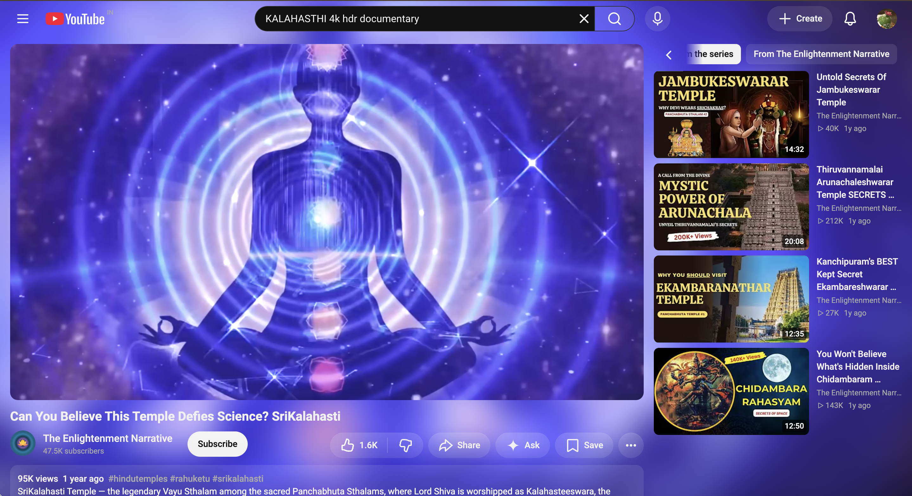
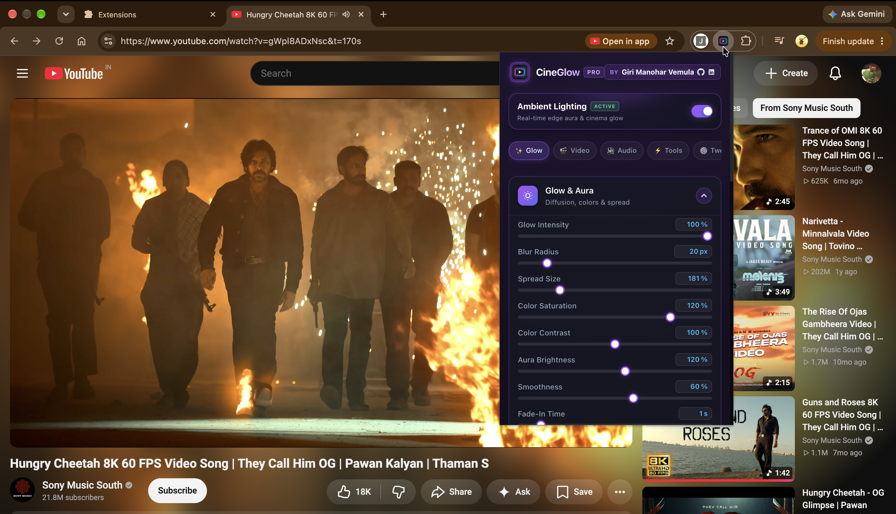
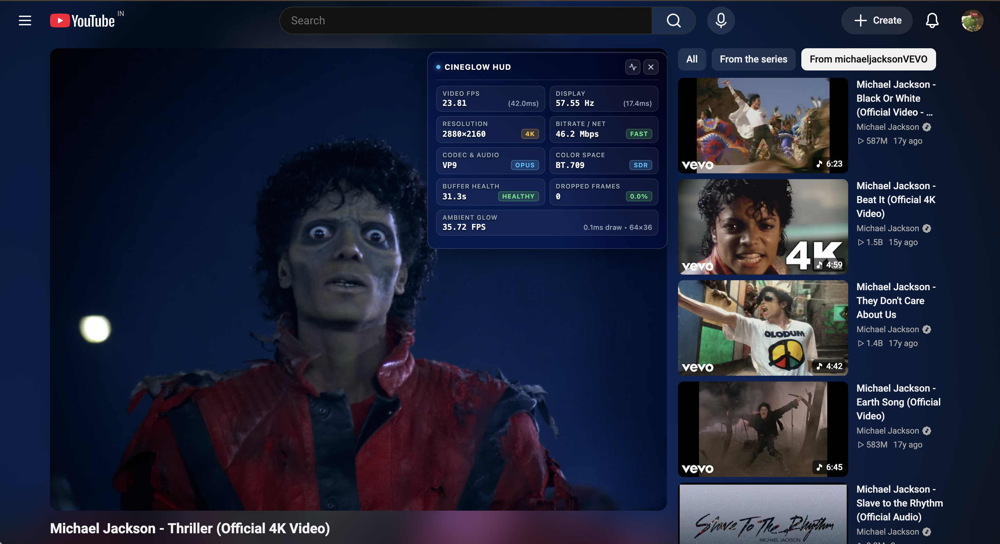
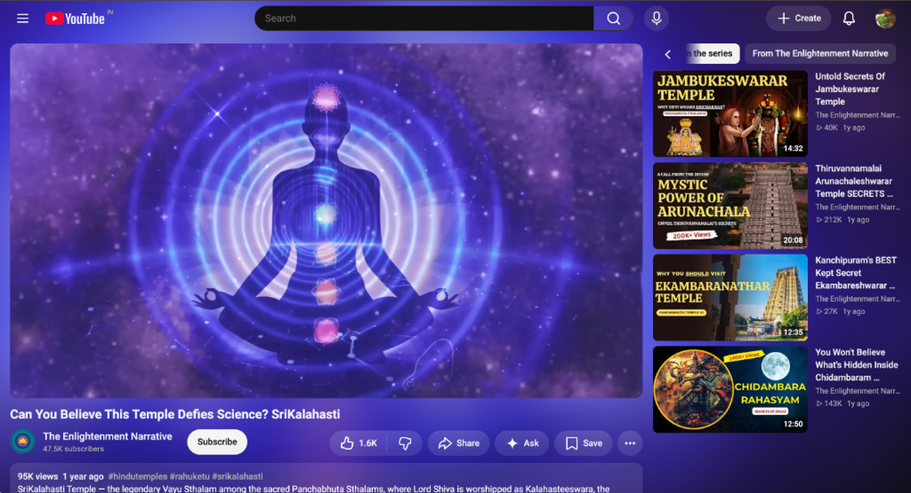

# YouTube CineGlow Pro

I got tired of watching YouTube in a dark room and staring at a bright rectangle floating in blackness. CineGlow fixes that. It reads the edge colors from every video frame and projects a soft, color-matched glow onto the page behind the player — the same idea as Ambilight TVs, but running entirely inside a Chrome extension.

Along the way I added the other things I kept wishing YouTube had: ad skipping, a volume normalizer that stops explosions from blowing out my speakers, auto-pause when I switch tabs, and a one-click PiP button that YouTube hides behind a double right-click.

## Showcase

|  |  |
|:---:|:---:|
| Ambient glow reacting to video edge colors | Settings popup with glow, video, and audio controls |

|  |  |
|:---:|:---:|
| Live telemetry: FPS, dropped frames, bitrate, codec | Full-page theatre mode with edge lighting |

|  |
|:---:|
| Floating toolbar with PiP toggle and lossless PNG screenshot capture |

## What It Does

- Samples each video frame into a 64×36 offscreen canvas, blurs and stretches the result behind the player to create a live ambient glow.
- Skips video ads and blocks tracker network requests using Manifest V3 declarative rules.
- Injects a floating toolbar next to the player with buttons for Picture-in-Picture and full-resolution PNG frame capture.
- Normalizes audio through a Web Audio gain node, boosting quiet dialogue up to 300% without clipping.
- Pulses the glow brightness in sync with bass frequencies by reading a real-time FFT from the audio stream.
- Pauses playback when you leave the tab or minimize the window. Resumes when you come back.
- Applies per-video brightness, contrast, and blue-light (sepia) filters for late-night viewing.
- Detects letterbox black bars on cinematic content and zooms the video to fill the screen.
- Overlays a draggable stats HUD showing true display FPS, dropped frames, bitrate, codec, and color space.

## Installation

1. Clone the repository:
   ```bash
   git clone https://github.com/ManoharVit/YouTube-CineGlow.git
   ```
2. Open Chrome → `chrome://extensions` → enable **Developer mode**.
3. Click **Load unpacked** and select the cloned folder.
4. Play any YouTube video. Dark mode gives the best visual result.

## How the Rendering Works

1. **Sample** — On each animation frame, `drawImage()` copies the current video frame onto a tiny 64×36 canvas.
2. **Smooth** — New pixel values are blended into the previous frame using an exponential moving average, which prevents flickering during fast cuts.
3. **Display** — The canvas is scaled larger than the video and placed behind it (`z-index: -1`). CSS `blur()` and `saturate()` filters spread the color outward to produce the glow.
4. **Idle** — The rendering loop stops the moment the video pauses, the tab loses focus, or the user navigates away from the watch page. No background CPU burn.

## Project Structure

```
manifest.json              Manifest V3 config: permissions, service worker, content scripts
background/background.js   Service worker handling codec script registration and messaging
content/
  player-manager.js        Centralized player lifecycle — detects video/SPA changes via URL tracking
  content.js + content.css Glow renderer: canvas sampling, blur, layout, and CSS variables
  stats-overlay.js + .css  Draggable HUD: display FPS, dropped frames, bitrate, codec info
  blackbar.js              Letterbox detection via pixel scanning on a downscaled canvas
  pip-button.js            Injects a PiP toggle button into the YouTube player controls
  screenshot-button.js     Floating toolbar button that captures lossless PNG frames
  audio-processor.js       Web Audio gain/analyser nodes for volume boost and beat detection
  smart-pause.js           Pauses playback on tab switch or window minimize
  youtube-ads.js           Ad overlay detection and skip-button automation
  youtube-quality.js       Forces preferred resolution on video load
  main-world.js            MAIN-world script for codec capability overrides
popup/
  popup.html + .css + .js  Extension popup: category tabs, sliders, toggles, direction pad
shared/defaults.js         Single source of truth for all default setting values
rules/adblock.json         Declarative network request rules blocking ad/tracker domains
store_assets/              Screenshots and promo graphics for the Chrome Web Store listing
```

## Author

**G.Manohar.V** · [@ManoharVit](https://github.com/ManoharVit) · [LinkedIn](https://www.linkedin.com/in/manohar511/)

## License

[MIT](LICENSE) © 2026 Giri Manohar Vemula
